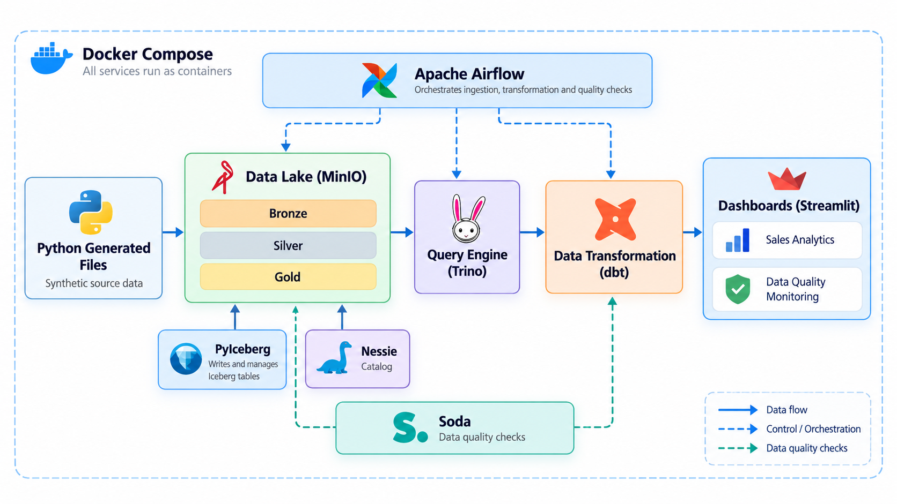
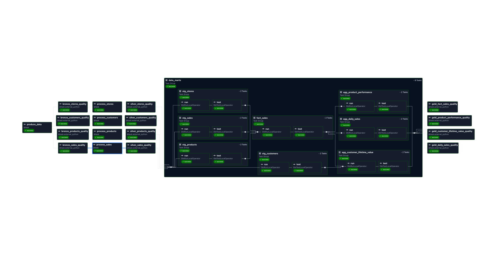
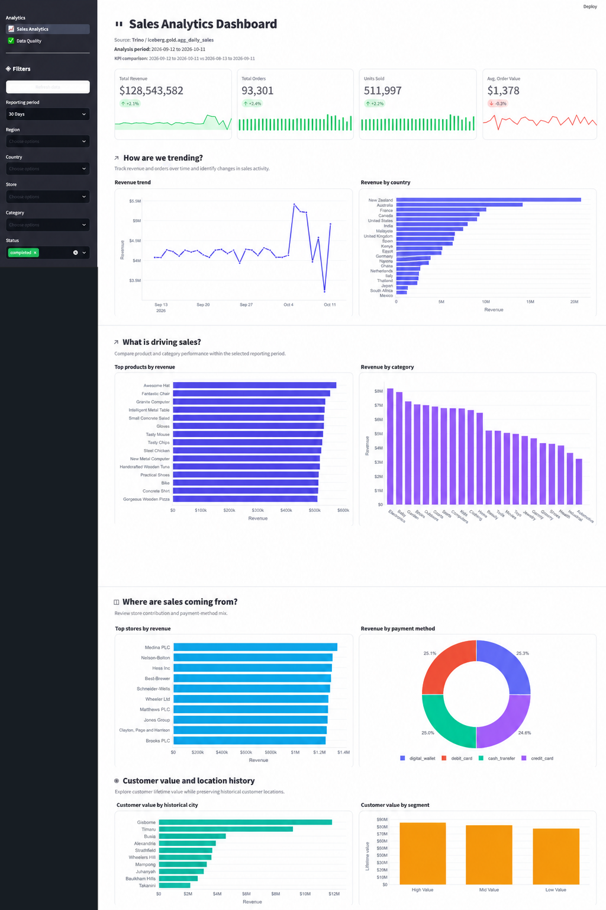
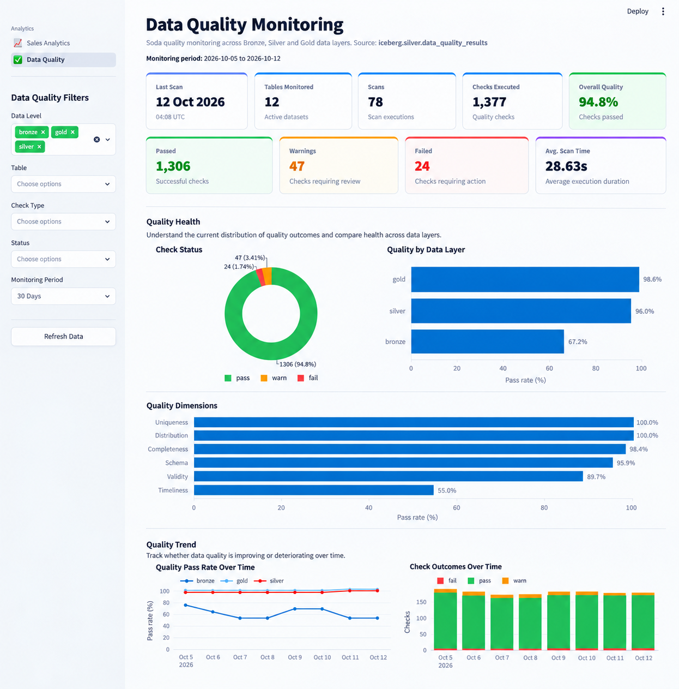

# OpenLakehouse: End-to-End Data Engineering, Quality & Analytics Platform


## Overview

OpenLakehouse is a containerised, open-source **batch data pipeline and lakehouse platform** that demonstrates an end-to-end modern data engineering workflow. Python-generated source files are ingested into a Bronze layer, transformed into Silver Iceberg tables, modelled into Gold analytics tables, validated with automated data quality checks, queried with SQL, and presented through interactive dashboards.

The platform follows a Bronze, Silver, and Gold medallion architecture and is designed as a reproducible local environment for development, learning, demonstration, and experimentation.

The platform uses:

- [Docker Compose](https://docs.docker.com/compose/) for container orchestration
- [Apache Airflow](https://airflow.apache.org/) for batch workflow orchestration
- [PostgreSQL](https://www.postgresql.org/) for Airflow metadata storage
- [Redis](https://redis.io/) for Celery task brokering
- [MinIO](https://min.io/) for S3-compatible object storage
- [Project Nessie](https://projectnessie.org/) for Iceberg catalog management
- [Apache Iceberg](https://iceberg.apache.org/) as the lakehouse table format
- [PyIceberg](https://py.iceberg.apache.org/) for creating, writing, and managing Iceberg tables
- [Trino](https://trino.io/) for querying Silver and Gold data
- [dbt](https://www.getdbt.com/) for transforming Silver data into Gold analytics models
- [Soda Core](https://docs.soda.io/soda-core/overview.html) for automated data quality checks
- [Streamlit](https://streamlit.io/) for Sales Analytics and Data Quality Monitoring dashboards

## Architecture

The architecture below shows how Python-generated source files move through the batch lakehouse pipeline. Airflow orchestrates the workflow, PyIceberg manages Iceberg tables, Nessie provides the catalog, dbt transforms Silver data into Gold models, Soda performs quality checks, Trino queries Silver and Gold, and Streamlit provides the visualisation layer.



## Airflow DAG

The Airflow DAG orchestrates the complete batch pipeline from source-data generation through Bronze, Silver, and Gold processing, with data quality validation at each stage.



Airflow schedules and coordinates each task so that downstream processing only proceeds after the preceding stage completes successfully.

## Visualisation

The Streamlit application provides two main views: **Sales Analytics** for business-facing analysis and **Data Quality Monitoring** for operational data-quality observability.

### Sales Analytics

The Sales Analytics dashboard queries Gold aggregate tables through Trino and provides interactive filtering, KPI cards, revenue and order analysis, product and store performance, payment analysis, and customer lifetime insights.



### Data Quality Monitoring

The Data Quality dashboard queries `iceberg.silver.data_quality_results` and provides pass/fail/warning KPIs, quality trends, data-layer health, schema diagnostics, failed and warning checks, status history, and paginated check-level results.



## Minimum Resources

For the complete stack, use at least:

| Resource | Recommended |
| --- | ---: |
| CPU | 4+ cores |
| Memory | 8+ GB RAM |
| Free disk | 20+ GB |

## Required Software

Install:

- Docker Engine or Docker Desktop
- Docker Compose v2
- Git

## Required Ports

| Service | Port |
| --- | ---: |
| Airflow | 8080 |
| Trino | 8089 |
| Streamlit | 8501 |
| MinIO API | 9000 |
| MinIO Console | 9001 |
| Nessie | 19120 |

## Data Flow

The implementation follows a medallion-style lakehouse architecture:

1. **Bronze Layer**
   - Python generates the source datasets.
   - Raw Parquet files are stored in MinIO.
   - Soda validates incoming datasets before downstream processing.

2. **Silver Layer**
   - Bronze data is cleaned, standardised, and enriched.
   - PyIceberg writes the transformed data as Apache Iceberg tables.
   - Nessie manages the Iceberg catalog and metadata.
   - Soda validates transformed Silver datasets.

3. **Gold Layer**
   - dbt transforms Silver datasets into analytics-ready fact and aggregate models.
   - Gold models are stored as Iceberg tables.
   - Soda performs final Gold-layer quality validation.

4. **Analytics Layer**
   - Trino queries both Silver and Gold Iceberg tables.
   - Streamlit uses Trino as the query layer.
   - Sales Analytics consumes Gold analytical models.
   - Data Quality Monitoring consumes persisted quality results from Silver.

## Project Structure

```text
.
├── airflow/
│   ├── dags/
│   ├── logs/
│   ├── config/
│   ├── plugins/
│   ├── src/
│   │   ├── processors/
│   │   └── utils/
│   ├── dbt/
│   │   ├── iceberg_datalake/
│   │   └── profiles/
│   │       └── profiles.yml
│   └── data_quality/
├── initdb/
├── streamlit/
│   ├── app.py
│   ├── pages/
│   ├── Dockerfile
│   └── .streamlit/
├── trino/
│   ├── catalog/
│   └── coordinator/
├── assets/
├── docker-compose.yml
├── Dockerfile
├── .env
└── README.md
```

## 1. Clone the Repository

```bash
git clone https://github.com/oseghalepatrick/batch-data-lakehouse.git
cd batch-data-lakehouse
```

The repository contains the Docker Compose configuration, Airflow DAGs, PyIceberg processors, dbt project, Soda checks, Trino configuration, and Streamlit application required to reproduce the platform locally.

## 2. Create the Environment File

Rename the provided example environment file to `.env`:

```bash
cp .env.example .env
```

On Linux, add your Airflow user ID:

```bash
echo "AIRFLOW_UID=$(id -u)" >> .env
```

Update `.env` with the credentials and environment-specific values required by your local Docker configuration.

> Do not commit `.env`, real credentials, or secrets to source control. Keep `.env.example` in the repository as the replication template.


## 3. Verify the Required Project Directories

Ensure that the mounted directories exist:

```bash
mkdir -p airflow/dags
mkdir -p airflow/logs
mkdir -p airflow/config
mkdir -p airflow/plugins
mkdir -p airflow/src
mkdir -p airflow/dbt/iceberg_datalake
mkdir -p airflow/dbt/profiles
mkdir -p airflow/data_quality
mkdir -p trino/catalog
mkdir -p trino/coordinator
mkdir -p streamlit/pages
mkdir -p streamlit/.streamlit
mkdir -p initdb
```

## 4. Configure Trino

Place the coordinator configuration in:

```text
trino/coordinator/config.properties
```

Place the Iceberg catalog configuration in:

```text
trino/catalog/
```

The catalog must connect Trino to:

- Project Nessie for Iceberg metadata
- MinIO for S3-compatible object storage

## 5. Configure PostgreSQL

Place any required database bootstrap SQL in:

```text
initdb/
```

These scripts are mounted into PostgreSQL during initialisation.

## 6. Build and Start the Stack

The project uses a custom Airflow image based on:

```dockerfile
FROM apache/airflow:3.3.2
```

The image installs the main Airflow dependencies, creates an isolated Soda Python 3.11.8 environment, and exposes the dbt paths used by the project.

Key runtime paths:

```text
PYTHONPATH=/opt/airflow
DBT_PROFILES_DIR=/opt/airflow/dbt/profiles
DBT_PROJECT_DIR=/opt/airflow/dbt/iceberg_datalake
Soda Python=/opt/airflow/soda_venv/bin/python
```

Build and start all services:

```bash
docker compose up -d --build
```

Check service status:

```bash
docker compose ps
```

## 7. Verify Services

### Airflow

Open:

<http://localhost:8080>

Expected components:

```text
airflow-apiserver
airflow-scheduler
airflow-dag-processor
airflow-worker
airflow-triggerer
```

### MinIO

Console:

<http://localhost:9001>

API:

<http://localhost:9000>

Expected bucket:

```text
warehouse
```

### Nessie

Open:

<http://localhost:19120>

Expected warehouse location:

```text
s3://warehouse/
```

### Trino

Connect to:

<http://localhost:8089>

Validate the catalog:

```sql
SHOW CATALOGS;
SHOW SCHEMAS FROM iceberg;
```

### Streamlit

Open:

<http://localhost:8501>

## 8. Configure the Airflow Pipeline

Place DAGs under:

```text
airflow/dags/
```

Expected flow:

```text
Python-Generated Files
        |
        v
Bronze
        |
        v
Bronze Data Quality
        |
        v
Silver Transformation
        |
        v
Silver Data Quality
        |
        v
dbt Gold Transformation
        |
        v
Gold Data Quality
```

## 9. Bronze Storage Convention

Raw Python-generated source data is persisted to the Bronze area of the MinIO warehouse.

Dimension datasets:

```text
dimensions/<table>/<table>.parquet
```

Other Bronze datasets:

```text
<table>/<table>.parquet
```

## 10. Silver Layer

Transform Bronze data into Apache Iceberg tables.

Silver tables should be:

- written and managed with PyIceberg;
- registered through Nessie;
- stored in MinIO;
- queryable through Trino.

## 11. dbt Gold Layer

The dbt project is stored under:

```text
airflow/dbt/iceberg_datalake/
```

The Airflow Docker image already exposes the dbt project and profile locations:

```dockerfile
ENV DBT_PROFILES_DIR=/opt/airflow/dbt/profiles
ENV DBT_PROJECT_DIR=/opt/airflow/dbt/iceberg_datalake
```

Create the local profile file at:

```text
airflow/dbt/profiles/profiles.yml
```

Example profile:

```yaml
iceberg_datalake:
  outputs:
    dev:
      type: trino
      method: none
      user: airflow
      host: trino
      port: 8089
      catalog: iceberg
      schema: silver
      threads: 1

  target: dev
```

The `profiles` directory is intentionally excluded through `.gitignore` because it may contain environment-specific connection settings or credentials.

> Do not commit `profiles.yml` or sensitive credentials to the repository.

Because `DBT_PROFILES_DIR` and `DBT_PROJECT_DIR` are already configured in the Airflow image, dbt commands can be run without passing `--profiles-dir` or `--project-dir` explicitly.

Typical validation commands:

```bash
dbt debug
dbt run
dbt test
```

In normal operation, dbt is executed through Airflow and transforms Silver Iceberg tables into Gold analytics models.

## 12. Data Quality

Soda configuration, SodaCL checks, scan processing, and result transformation are stored under:

```text
airflow/data_quality/
```

The Airflow Docker image creates an isolated Python 3.11.8 environment for Soda:

```text
/opt/airflow/soda_venv
```

Soda dependencies are installed from:

```text
airflow/soda_requirements.txt
```

This isolates Soda and its Dask dependencies from the main Airflow Python environment.

Data quality checks run against:

- Bronze Parquet files in MinIO;
- Silver Iceberg tables through Trino;
- Gold Iceberg tables through Trino.

Processed quality results are persisted into:

```text
iceberg.gold.data_quality_results
```

The persisted results are queried by the Streamlit Data Quality Monitoring dashboard.

## 13. Validate the Data

List Silver and Gold tables:

```sql
SHOW TABLES FROM iceberg.silver;
SHOW TABLES FROM iceberg.gold;
```

Check a Gold aggregate:

```sql
SELECT *
FROM iceberg.gold.agg_daily_sales
LIMIT 10;
```

Check persisted data-quality results:

```sql
SELECT *
FROM iceberg.gold.data_quality_results
ORDER BY scan_start_ts DESC
LIMIT 100;
```

## 14. Run the Pipeline

Trigger the DAG from Airflow and verify the workflow:

```text
Bronze
-> Bronze DQ
-> Silver
-> Silver DQ
-> Gold
-> Gold DQ
```

## 15. Validate the Dashboards

Open:

<http://localhost:8501>

Confirm that:

- Sales Analytics queries Gold tables through Trino.
- Data Quality Monitoring queries `gold.data_quality_results`.
- dashboard filters work correctly.
- failures and warnings appear in Quality Diagnostics.
- visualisations load successfully.

## Replication Checklist

Before triggering the pipeline, confirm that:

- Docker and Docker Compose are installed;
- required project directories exist;
- `.env` has been created;
- `airflow/dbt/profiles/profiles.yml` has been created locally;
- the dbt profile points to `host: trino` and `port: 8089`;
- Trino can access the `iceberg` catalog;
- Nessie is reachable;
- the MinIO `warehouse` bucket exists;
- Airflow services are healthy;
- the Streamlit application can reach Trino.

Once these checks pass, trigger the Airflow DAG and validate the Bronze, Silver, Gold, data quality, and dashboard outputs.

## Useful Commands

Check all services:

```bash
docker compose ps
```

Follow Airflow scheduler logs:

```bash
docker compose logs -f airflow-scheduler
```

Follow Airflow worker logs:

```bash
docker compose logs -f airflow-worker
```

Follow Trino logs:

```bash
docker compose logs -f trino
```

Follow Nessie logs:

```bash
docker compose logs -f nessie
```

Follow Streamlit logs:

```bash
docker compose logs -f streamlit
```

Restart the stack:

```bash
docker compose down
docker compose up -d
```

Rebuild the stack:

```bash
docker compose up -d --build
```

Remove containers and volumes:

```bash
docker compose down -v
```

> **Warning:** `docker compose down -v` removes persistent Docker volumes and can delete stored project data.
